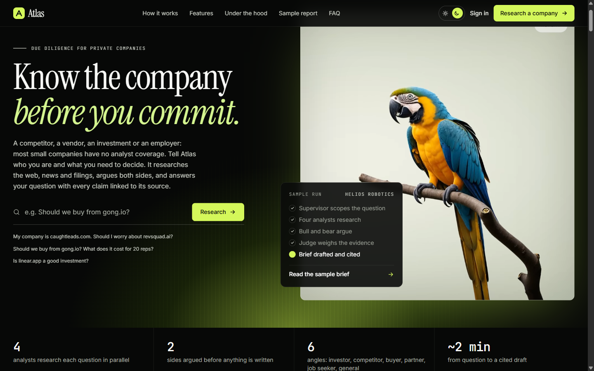
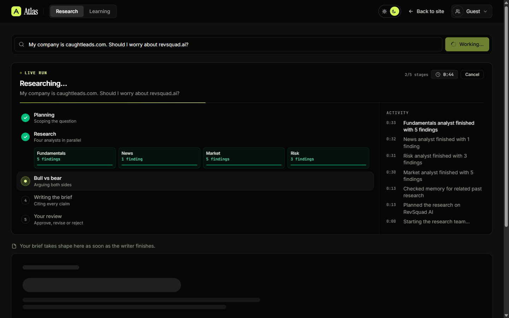
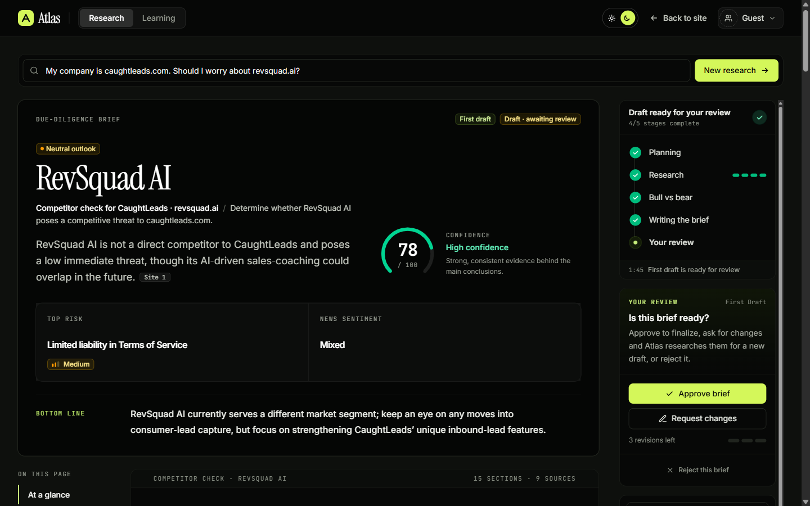
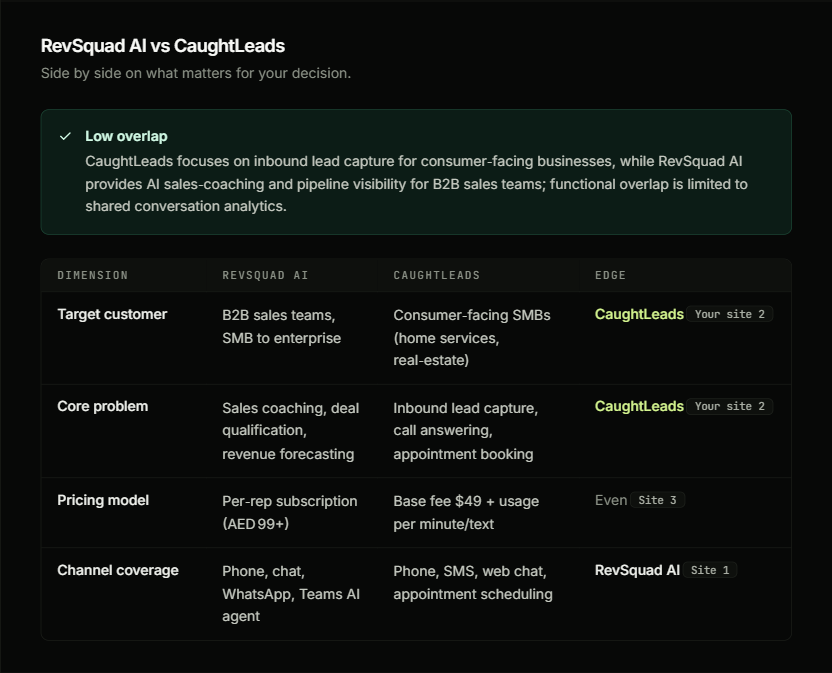
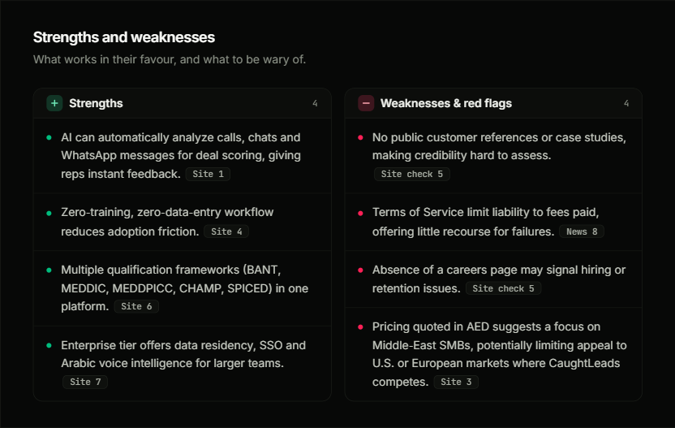
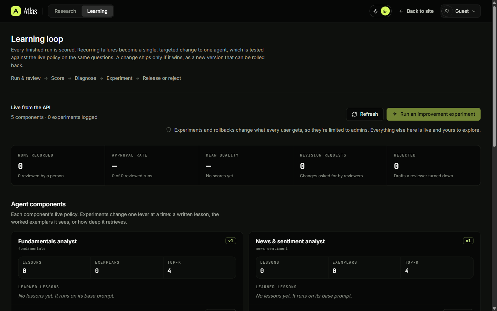

<div align="center">

# 🛰️ Atlas — Autonomous Due-Diligence Desk

**Due diligence on the companies chat assistants know nothing about — small, private and mid-sized. A team of specialist AI agents reads the company's own website, reviews, LinkedIn and funding signals, _debates bull vs. bear_, and answers _your_ question (investor, competitor, buyer, partner, job seeker) with every claim linked to its source.**

[](https://atlas-web-lake.vercel.app)
[](https://github.com/hari9618/atlas-agentic-research/actions/workflows/ci.yml)
[](https://github.com/hari9618/atlas-agentic-research/actions/workflows/deploy.yml)
[](https://www.python.org/)
[](https://langchain-ai.github.io/langgraph/)
[](https://console.groq.com/)
[](https://fastapi.tiangolo.com/)
[](https://nextjs.org/)
[](https://qdrant.tech/)
[](https://langfuse.com/)
[](https://www.docker.com/)
[](#-testing)

_Multi-agent orchestration · agentic hybrid RAG · private-company research · production auth & encryption · statistically gated self-improvement · live agentic evals._

</div>

---

## 🚀 Live demo

**[atlas-web-lake.vercel.app](https://atlas-web-lake.vercel.app)** — the full war-room UI, live.

> Try: _"My company is caughtleads.com. Should I worry about revsquad.ai?"_ or
> _"Should we buy from gong.io? What does it cost for 20 reps?"_ — click **Try the demo** for a
> no-signup guest session (3 runs/hour). The first request may take **~50 s** while the free-tier
> backend wakes up. The public demo runs a lightweight retrieval profile to fit free
> infrastructure (see [Deployment](docs/deployment.md)).

---

## 🎯 What it does

Chat assistants already summarize NVIDIA. The questions people actually need answered are about
companies with **no stock, no filings and no press** — a new competitor, a vendor you're about to
sign, a startup you might invest in or join. Ask Atlas:

> _"My company is caughtleads.com. Should I worry about revsquad.ai?"_

1. A **supervisor** writes a research brief: the **subject** (RevSquad), the **asker** (CaughtLeads),
   the **persona** (competitor), the **goal** and any **extra asks** — model-drafted, then verified
   by rules so Atlas never researches the asker by mistake.
2. Four **specialists** research in parallel from the company's **own website** (SSRF-safe reader),
   **reviews** (G2, Capterra, Trustpilot, Reddit), **employee reviews**, **LinkedIn & funding** via
   search, **"alternatives to" pages** and **your own site** — plus SEC filings, stock data and news
   when the company is public.
3. A **Bull ⇄ Bear debate** argues both sides; a **Synthesizer + Judge** writes a report shaped for
   the reader: **verdict · snapshot · strengths · weaknesses & red flags · pricing · customer praise
   & complaints · them-vs-you table · answers to your extra questions** — with a confidence score
   and an explicit "what we're not sure about".
4. You **approve, request changes, or reject**. That review feeds the learning loop.

Live answer to the question above: _"Low threat — monitor. RevSquad sells AI sales coaching to B2B
sales teams; CaughtLeads captures inbound calls for consumer-facing businesses"_ — with RevSquad's
real per-rep pricing and four sourced weaknesses (screenshots below).

## ✨ Why this project stands out

| | |
|---|---|
| 🧠 **True multi-agent orchestration** | A real **LangGraph** graph: supervisor → memory recall → four parallel specialists → bull/bear debate → synthesizer/judge → human review, with **Postgres-checkpointed**, encrypted state that survives restarts. |
| 🕵️ **Built for private companies** | Persona-aware research brief, safe website crawler (public IPs only, robots.txt, hidden-text stripping), review/LinkedIn/funding/alternatives evidence, and a report that answers *your* question first. |
| 🔍 **Agentic hybrid RAG** | **BM25 + bge dense** fused with **RRF**, a **cross-encoder re-ranker**, and a **CRAG** loop that grades evidence and falls back to the live web when it's weak. An entity guard keeps evidence about the *right* company. |
| 🔐 **Production security** | Argon2id accounts + guest demo, 15-min JWTs with **rotating refresh tokens** (reuse detection) in an httpOnly cookie, RBAC, **AES-256-GCM encryption at rest** with key rotation, TLS to Postgres, audit log. |
| ⚖️ **Built to scale out** | Stateless API behind **nginx (least_conn, SSE-safe)**, **GCRA rate limits** + run admission on Redis/Postgres, circuit breakers, bulkheads, caching and Retry-After-aware retries per provider. |
| 📈 **Self-improvement that has to prove itself** | Failures are attributed to one agent → one bounded change (a lesson, exemplars, or retrieval depth) → **paired replay on a holdout benchmark** → released only on a statistically real gain, after admin approval. |
| 🧪 **Tested like a product** | 400+ offline tests on real Postgres + Redis in CI, plus a **live agentic eval** (DeepEval) that runs persona scenarios end to end and judges the reports. |
| 🗂️ **Four memory layers** | Working (state) · Semantic (RAG) · **Episodic, scoped per user and per company** · Procedural (playbooks). |
| 👁️ **Observability-first** | Every agent node and tool call traced in **Langfuse** with tokens and cost. |
| 💸 **$0 to run** | Groq free tier, local embeddings, free Tavily/SEC, self-hostable Qdrant & Langfuse. |

## 🖥️ Screenshots

<div align="center">



**Live run — four analysts research in parallel, then argue both sides**



**The brief answers the reader's question first — verdict, confidence, top risk, bottom line**



**Them vs. you, and sourced strengths and weaknesses**

 

**Learning loop — every component's live policy, experiments and rollbacks**



</div>

## 🏗️ Architecture

```
Browser ──> Next.js (BFF: httpOnly session cookie) ──SSE──> nginx (least_conn) ──> FastAPI × N
                                                                              │
   auth (JWT + refresh rotation) · rate limits (GCRA) · run admission · audit │
                                                                              ▼
   SUPERVISOR (research brief) → recall (same user + same company) →
   [ Fundamentals · News/Sentiment · Risk · Market ]  (parallel) →
   BULL ⇄ BEAR debate → SYNTHESIZER + JUDGE → human review → remember → cited report

  Evidence      own website · reviews · employees · LinkedIn/funding · alternatives · asker's site
                · SEC EDGAR · stock data · news · uploaded documents
  Hybrid RAG    BM25 + bge (RRF) → cross-encoder → CRAG (grade → web fallback) → Qdrant/InMemory
  State         Postgres (checkpoints, users, records — AES-256-GCM encrypted) · Redis (limits)
  LLM-Ops       record → diagnose → one change → paired replay → gate → admin approval → release
```

## 🤖 Meet the agents

Atlas is a **team**, not a prompt chain. Each agent has a single job, its own procedural playbook, and evidence-grounded output:

| Agent | Role |
|---|---|
| 🧭 **Supervisor** | Writes the research brief (subject · asker · persona · goal · extra asks), verifies it, and dispatches the four specialists in parallel. |
| 📊 **Fundamentals** | Digs into financials, filings, and business model — the numbers behind the company. |
| 📰 **News / Sentiment** | Reads recent news and gauges momentum, tone, and market perception. |
| ⚠️ **Risk** | Hunts for red flags — competition, regulation, concentration, execution risk. |
| 🏹 **Market** | Sizes the market and maps competitive positioning. |
| 🐂 **Bull** vs 🐻 **Bear** | Debate the evidence — one argues the upside, one argues the downside. |
| ⚖️ **Synthesizer + Judge** | Weighs both sides into a **cited report** with a **confidence score** and a "what we're not sure about" section. |
| 📝 **Summarizer** | Runs on a cheaper model to distill past runs (episodic memory) into durable semantic facts. |

Every agent node attaches Langfuse callbacks, so the whole run shows up as a **traceable, costed span tree**.

## 🔍 Agentic hybrid RAG pipeline

Retrieval is designed so nothing gets missed and nothing weak slips through:

```
query
  ├─▶ BM25Retriever            (exact keywords, tickers, names)
  └─▶ bge-small dense vectors  (semantic meaning)
        │
        ▼
   EnsembleRetriever (RRF)     fuse both rankings
        ▼
   CrossEncoderReranker        re-score top candidates for true relevance
        ▼
   CRAG grade ── weak? ──▶ rewrite query + re-search (self-correction)
        │ strong
        ▼
   grounded evidence (with provenance) → agents
```

- **Hybrid** because pure semantic search misses exact terms (tickers, product names) and pure keyword search misses meaning — you need both.
- **CRAG** means the system doesn't blindly trust its first retrieval: it grades the context and re-searches when it's weak.
- **Provenance everywhere** — every chunk carries its source so the grounding guardrail can enforce citations.

## 🔁 The self-improving learning loop

Atlas changes **what each agent is given**, not the model's weights: a short written **lesson**,
a few **worked exemplars**, or **how much evidence it retrieves**. That is cheap, reversible and
measurable — and every change has to prove itself before anyone sees it:

```
every run ─▶ auto-eval + your review (approve / revise / reject) ─▶ run record
                                                                      │
   diagnose: which ONE agent caused the failures? (human feedback weighs most)
                                                                      ▼
   propose ONE bounded change  ─▶  paired replay: old vs new policy on the SAME
   (lesson · exemplars · top-k)     6-question holdout benchmark, ≥ 4 trials
                                                                      ▼
   gate: ≥ 75% of questions improve AND bootstrap 97.5% lower bound > 0, no failed trials
                                                                      ▼
   admin approves the exact lesson text ─▶ release as a new version ─▶ auto-rollback on regression
```

- **Honest about noise** — in simulation ~4% of useless changes pass the gate, while ~95% of real
  +0.08 improvements do (tested in `tests/test_learning_loop.py`).
- **Safe input** — only signed-up reviewers count, degraded runs teach nothing, and lessons with
  links or instruction-hijack phrasing are refused.

## 🧰 Tech stack

| Layer | Choice |
|---|---|
| **Orchestration** | LangGraph (supervisor + specialist nodes, Postgres/SQLite checkpointer) |
| **LLM** | Groq · GPT-OSS-120B (`openai/gpt-oss-120b`); GPT-OSS-20B (`openai/gpt-oss-20b`) for cheap ops tasks |
| **RAG** | LangChain hybrid: `BM25Retriever` + `bge-small-en-v1.5` (EnsembleRetriever/RRF) → `CrossEncoderReranker` → CRAG · Qdrant/InMemory |
| **Embeddings** | `BAAI/bge-small-en-v1.5` — free, local (sentence-transformers) |
| **Memory** | Episodic (Postgres/SQLite + embeddings, scoped per user) · Procedural (playbook files) · Summarizer agent |
| **Tools** | MCP server: web_search (Tavily) · sec_edgar · stock_data (stooq) · company_news |
| **Backend** | FastAPI + SSE streaming |
| **Observability** | Langfuse (trace/eval/cost) + Ragas + self-improving LLM-Ops loop |
| **Frontend** | Next.js + Tailwind (hand-rolled war-room components) |
| **Auth & security** | Argon2id · JWT (HS256) + rotating refresh tokens · AES-256-GCM at rest · audit log |
| **Scale** | nginx least_conn · Redis/Postgres GCRA rate limits · circuit breakers & bulkheads |
| **Evaluation** | Ragas · claim-level citation verifier · DeepEval live agentic scenarios |
| **Infra** | Docker Compose (nginx + api × N + redis + qdrant + langfuse + web) · Render + Vercel · GitHub Actions |

## 🚀 Quickstart (local)

```bash
# 1. Configure — only GROQ_API_KEY is required (free key: https://console.groq.com/keys)
cp apps/api/.env.example apps/api/.env

# 2. Bring up infra (Qdrant + self-hosted Langfuse)
docker compose up -d qdrant langfuse

# 3. Run the API
cd apps/api
pip install -e ".[dev]"
uvicorn atlas.main:app --reload      # → http://localhost:8000  (docs at /docs)

# 4. Sanity check
curl http://localhost:8000/health
curl http://localhost:8000/health/ready    # shows which integrations are wired
```

Run the **war-room frontend**:

```bash
cd apps/web && npm install && npm run dev  # → http://localhost:3000
```

Or run the **whole stack** in containers:

```bash
cp apps/api/.env.example apps/api/.env
docker compose up                          # qdrant + langfuse + api + web
```

## 🔌 API endpoints

| Method | Path | Purpose |
|---|---|---|
| `GET` | `/health`, `/health/ready`, `/health/upstreams` | liveness, readiness, per-provider breaker state |
| `POST` | `/auth/register`, `/auth/login`, `/auth/guest` | create a session (guest = limited demo) |
| `POST` | `/auth/refresh`, `/auth/logout`, `/auth/logout-all` | rotate / revoke refresh tokens |
| `GET` | `/research/stream?q=...` | SSE stream of agent events (drives the UI) |
| `GET` | `/research/resume` | approve / revise / reject a paused draft |
| `POST` | `/research/sync` | run the pipeline and return the report |
| `GET`/`POST` | `/corpus/status`, `/corpus/upload`, `/corpus/text`, `/corpus/sec` | knowledge base (writes: admin) |
| `GET` | `/llmops/overview`, `/llmops/experiments` | learning-loop dashboard data |
| `POST` | `/llmops/improve`, `/llmops/experiments/{id}/approve`, `/llmops/rollback` | run / approve / roll back (admin) |
| `GET` | `/admin/audit` | security audit log (admin) |

## 🗂️ Project layout

```
apps/api/atlas/
  core/graph.py        LangGraph wiring (supervisor → recall → specialists → debate → synthesize → review → remember)
  core/agents/         research brief, specialists (4), debate (bull/bear/judge), synthesizer, report schema
  core/rag/            LangChain hybrid retrieval + CRAG, ingestion, embeddings
  core/memory/         episodic (per-user, encrypted), procedural (playbooks), summarizer
  core/llmops/         run records, diagnose, proposer, paired replay, improver (gate + approval + rollback)
  core/tools/          web_search (Tavily), website reader (SSRF-safe), sec, market (stock + news)
  security/            passwords, tokens, auth store, encryption at rest, rate limits, audit
  eval/                golden set, retrieval eval, Ragas → Langfuse scores
  routers/             health, auth, admin, research (SSE), corpus, llmops
  evals/agentic/       live persona scenarios judged with DeepEval
apps/web/              Next.js war-room frontend
data/corpus/           sample corpus (*.md tracked); other ingested docs gitignored
data/playbooks/        procedural-memory agent playbooks
docs/                  architecture + deployment runbook
.claude/               project subagents + skills that drove development
infra/nginx/          load balancer config (least_conn, SSE-safe)
CLAUDE.md              architecture, stack, conventions, milestones
```

## 🔬 Evaluation & evidence-auditability

Atlas is built to answer *"how do I know this is right?"*, not just produce an answer:

- **Provenance / trust tiers** — every chunk is `authoritative` / `web` / `derived`. Atlas's own consolidated memory is tagged `atlas_derived`, ranked below real sources, and marked in citations — so the summarizer can never quietly feed its own past output back as evidence (`core/rag/provenance.py`).
- **Claim-level citation verification** — grounding is checked per claim (*does the cited evidence actually support it?* → supported / partial / unsupported), deterministic-first with an LLM judge only for ambiguous cases. Yields **`citation_coverage`** (supported / total claims) and **`citation_correctness`** (supported / cited) — claim-level, not a count of citation markers.
- **Per-agent evaluation** — each specialist is scored individually, so a weak run attributes to a *specific* agent.
- **Scores a human can read** — every run gets seven scores, all out of 1 (higher is better; 0.70+ is Good, below 0.40 is Weak): *Answer relevancy* (does it answer the question?), *Faithfulness* (are statements backed by evidence?), *Context precision* (was the evidence on-topic?), *Context recall* (was everything the question needs found?), *Citation accuracy*, *Citation coverage* and an *Overall score*, plus a Good / Ok / Poor verdict. In Langfuse each score carries a one-line note such as "0.48 out of 1 · OK. 48% of the evidence the agents used was relevant"; the Learning page shows the averages with the same wording (`core/llmops/metrics.py`).
- **Version-controlled golden set** — `data/golden/golden.jsonl`: 23 cases across categories (fundamentals, competitor, risk, news, ambiguous, requires-web, entity-confusion, citation-grounding). Verifiable answers come from the corpus; behavioural cases carry **no fabricated ground truth**.
- **Baseline vs Atlas** — a simple *retrieve → single-LLM* baseline scored by the **same** evaluator, so you can measure whether the multi-agent + debate + verification architecture actually improves quality rather than just adding complexity:

```bash
make eval-baseline        # or: python -m atlas.eval.compare --limit N   (needs GROQ_API_KEY)
```

All metrics push to Langfuse (`ragas_*`, `citation_coverage`, `citation_correctness`).

## 🧪 Testing

```bash
cd apps/api && python -m pytest -q          # offline: stub LLM + hashing embedder, no keys needed
```

- **400+ offline tests** — contract-focused, with table tests for the research brief, the SSRF
  guard, citation-key stability, tenant-scoped memory, encryption and key rotation, token reuse
  detection, rate limits, and the learning-loop decision rule under simulated noise. CI runs them
  against **real Postgres 16 + Redis 7**.
- **Live agentic eval** (`apps/api/evals/agentic`, DeepEval) — persona scenarios (competitor,
  buyer, investor, public-company regression, prompt injection) run the real agents, then
  deterministic checks (right company, right reader, citations resolve) and judged metrics
  (answers the question, surfaces negatives, persona fit, faithfulness):

```bash
pip install -e ".[dev,agent-eval]"
python -m pytest evals/agentic -q -k caughtleads     # needs GROQ_API_KEY (+ TAVILY_API_KEY)
```

## 🚦 CI/CD

```
push to main ─▶ Atlas CI ─┬─ backend: ruff + pytest (Postgres + Redis services) + dependency audit
                          ├─ retrieval eval gate (quality must not regress)
                          └─ frontend: lint + typecheck + production build
                 all green ─▶ Atlas Deploy ─▶ Render deploy hook (this exact commit)
                                            ─▶ wait until /health reports that commit ─▶ API smoke test
                                            ─▶ Vercel deploy ─▶ web smoke test (pages, API URL, CORS)
weekly / manual ─▶ Atlas agent eval (live persona scenarios, results uploaded as an artifact)
```

An independent architecture review — 20 findings, what was fixed, what is still open — lives in
[docs/architecture-review.md](docs/architecture-review.md); the security design in
[docs/security.md](docs/security.md).

## 🗺️ Roadmap

- [x] **M0** Dev harness — CLAUDE.md, subagents, skills
- [x] **M1** Skeleton & rails — FastAPI, Groq client, Langfuse, config, Docker, CI
- [x] **M2** Hybrid RAG core — EnsembleRetriever + CrossEncoderReranker + CRAG, Ragas
- [x] **M3** Agents & orchestration — supervisor graph, 4 specialists (parallel), shared state, tools
- [x] **M4** Debate & synthesis — bull/bear/judge, cited report + confidence + grounding guardrail
- [x] **M5** War-room frontend — live agent graph, streaming debate, report view
- [x] **M6** Memory layers — episodic (SQLite + vectors), procedural (playbooks), summarizer agent
- [x] **M7** LLM-Ops — record → diagnose → one bounded change → paired replay → release / rollback
- [x] **M8** Production — accounts, JWT + refresh rotation, encryption at rest, rate limits, load balancer, audit
- [x] **M9** Private companies — research brief + personas, website/review/LinkedIn evidence, persona reports, agentic eval
- [ ] Next: provider-wide token budget + per-run deadline · verify statements before delivery · durable job queue

## 📝 Design notes

- **Graceful degradation** — the API boots without Groq / Langfuse / Qdrant configured, and `/health/ready` reports exactly what's wired.
- **Free / self-hostable everywhere** — Groq free tier, local bge embeddings, SEC EDGAR + Tavily free tiers, self-hosted Langfuse + Qdrant. Note: Groq's free tier caps tokens/minute, so the multi-run self-improvement loop may be rate-limited without a higher tier.
- **Grounding is non-negotiable** — no report claim exists without a retrieved-evidence citation; the guardrail enforces it.

---

<div align="center">

Built by **Hari Krishna T** · [LinkedIn](https://www.linkedin.com/in/hari-krishna-thota-06b850275) · [GitHub](https://github.com/hari9618)

_Atlas is a portfolio project demonstrating senior-grade agentic engineering._

</div>
